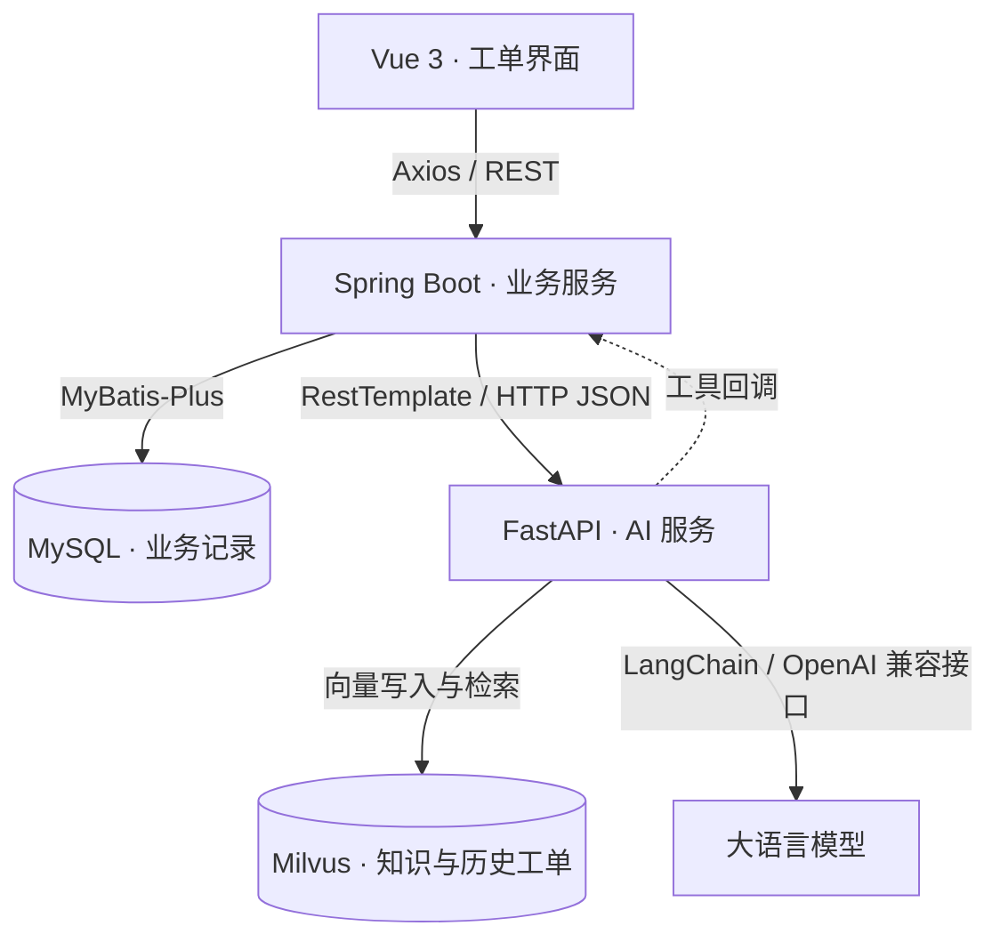
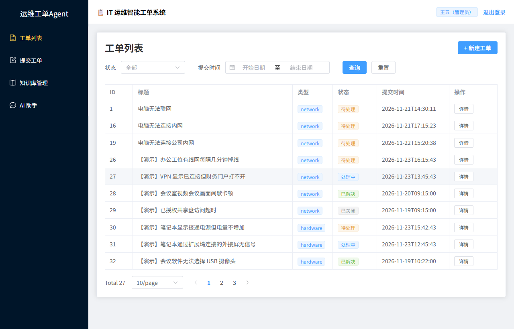
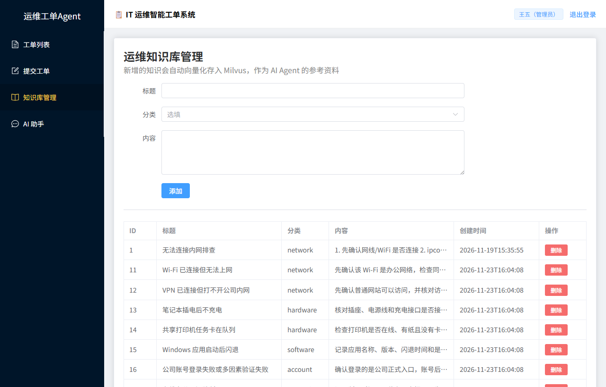

# IT 运维智能工单系统

面向办公 IT 支持的全栈项目。员工提交故障工单，运维人员更新处理进度。AI Agent 检索运维知识和历史工单，给出初步排查建议，也可通过对话查询工单。

## 技术栈

| 模块 | 技术 | 主要职责 |
| --- | --- | --- |
| [前端](ticket-frontend/) | Vue 3、Vite、Vue Router、Element Plus、Axios | 登录、工单页面、知识库管理、AI 对话 |
| [业务后端](ticket-backend/) | Java 17、Spring Boot 3.2、MyBatis-Plus、Sa-Token、MySQL 8 | 登录鉴权、业务接口、工单和知识数据持久化 |
| [AI 服务](ticket-agent/) | Python 3.12、FastAPI、Pydantic、LangChain | 请求校验、工单分析、模型接入和工具调用 |
| 向量检索 | Sentence Transformers、Milvus 2.6、Docker | 使用 `all-MiniLM-L6-v2` 生成 384 维向量，本地用 Docker 运行 Milvus |

## 接入方式与系统架构



- **浏览器到 Java**。开发环境由 Vite 将 `/api` 请求代理到 Spring Boot。登录后，Axios 为业务请求附上 `Authorization: Bearer <token>`。
- **Java 到 Python**。Spring Boot 通过 `RestTemplate` 调用 FastAPI 的 `/analyze` 和 `/chat` 等接口，用 JSON 传递工单、聊天消息和分析结果。
- **Python 到模型与业务接口**。LangChain 用 `ChatOpenAI` 接入支持工具调用的 OpenAI 兼容模型服务。Agent 用本地嵌入模型生成向量，并在需要查询或操作工单时通过 `requests` 携带内部令牌回调 Java。

## 实现功能

| 功能 | 实现内容 |
| --- | --- |
| 工单管理 | 提交、分页查询、按状态筛选和查看详情。运维人员可保存处理结果并更新状态，相关工单向量同步到 Milvus。 |
| 检索增强生成（RAG） | 根据标题和描述识别故障类型，按相似度筛选最多 1 条知识和 3 条历史工单。模型生成初步建议后，Java 保存建议及引用，并在详情页展示。 |
| 知识库管理 | 新增和删除知识条目时同步更新 Milvus。Milvus 的 `item_id` 对应 MySQL 的记录 ID，检索结果可关联回业务数据。 |
| AI 助手 | 用自然语言查询工单和详情、检索知识及历史案例，提供创建与更新工单的工具，并在对话页展示工具调用记录。 |
| 登录与界面角色 | 使用 Sa-Token 校验登录状态。界面根据员工或管理员角色显示菜单和工单编辑操作。 |

## 界面展示



<details>
<summary>查看知识库管理界面</summary>



</details>

## 本地运行

准备 JDK 17、Node.js 24、Python 3.12、MySQL 8 和 Milvus。MySQL 中需已有 `t_user`、`t_ticket`、`t_knowledge` 表和本地登录账号。数据源连接及 `agent.base-url` 在 [application.yml](ticket-backend/src/main/resources/application.yml) 中配置。

<details>
<summary>Python 服务配置示例</summary>

在 `ticket-agent` 目录创建 `.env`，填写你自己的模型地址、密钥和模型名。`AGENT_TOKEN` 与 Java 的 `agent.token` 使用同一个本地令牌。

```dotenv
OPENAI_API_KEY=
OPENAI_BASE_URL=
LLM_MODEL=
LLM_TEMPERATURE=0.2
EMBEDDING_MODEL=sentence-transformers/all-MiniLM-L6-v2
MILVUS_HOST=127.0.0.1
MILVUS_PORT=19530
MILVUS_KNOWLEDGE=knowledge
MILVUS_TICKET=ticket
SPRING_BOOT_BASE_URL=http://127.0.0.1:8080
AGENT_TOKEN=
```

`EMBEDDING_MODEL` 也可以填写已下载的模型目录。模型输出维度需与 Milvus 集合的 384 维配置一致。

</details>

从仓库根目录打开三个 PowerShell 终端，分别启动 AI 服务、业务后端和前端。

```powershell
# AI 服务，默认端口 8000（使用 Python 3.12 创建虚拟环境）
cd ticket-agent
python -m venv .venv
.\.venv\Scripts\python.exe -m pip install -r requirements.txt
.\.venv\Scripts\python.exe -m app.main
```

```powershell
# 业务后端，默认端口 8080
cd ticket-backend
.\mvnw.cmd spring-boot:run
```

```powershell
# 前端，默认端口 5173
cd ticket-frontend
npm ci
npm run dev
```

启动后访问 [本地工单系统](http://localhost:5173)。FastAPI 的接口可在 [Swagger UI](http://localhost:8000/docs) 查看。
